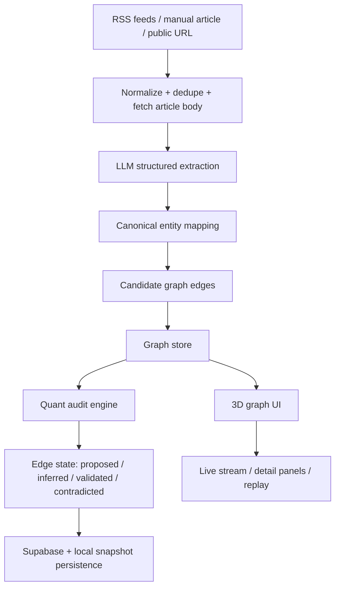
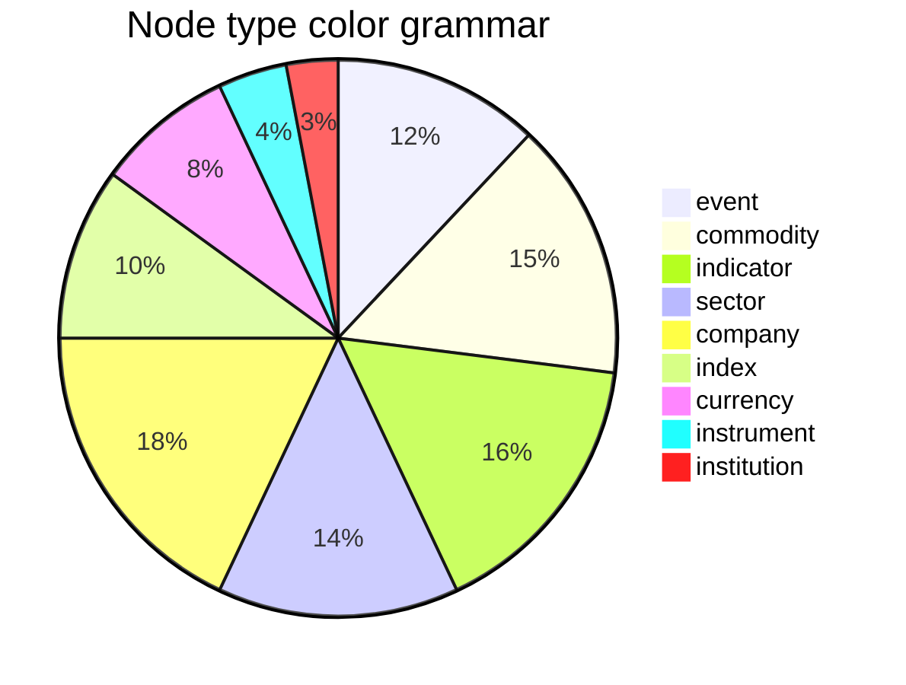
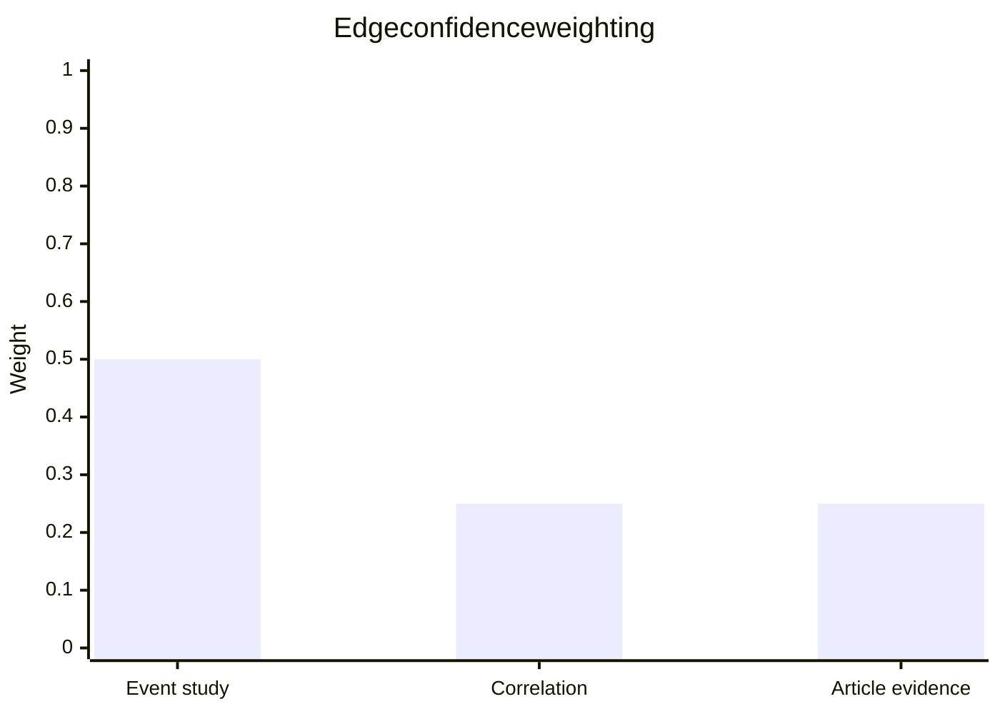
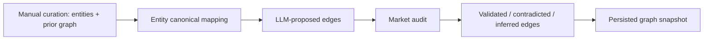
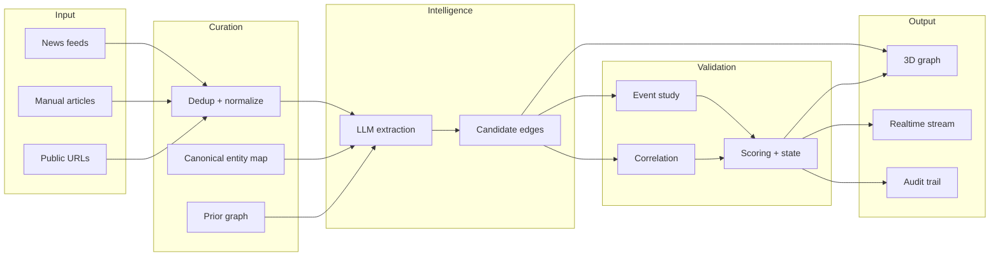

# Finfluence Architecture Deep Dive

This is the practical architecture behind the product: a real-time news-to-graph pipeline that turns unstructured financial headlines into a curated, audited market impact graph.

> Important: this repo is a hackathon prototype with illustrative market data. The checked-in market cache is designed for demos and replay, not for production investment advice.

---

## 1) Executive Summary

Finfluence combines three layers:

1. Text ingestion and normalization
2. LLM-driven hypothesis generation
3. Empirical evidence auditing with market data

The system does not trust the LLM as the final authority. It uses an LLM to propose edges and nodes from news text, then independently validates those relationships against historical price movement using event-study logic, lagged correlation, and explicit scoring thresholds.

So the product is fundamentally:

- News text in
- structured financial events out
- market evidence tested against historical data
- graph rendered visually with a 3D force layout

This gives the application a “human-like research engine” with an audit trail.

---

## 2) High-Level System View

---

## 3) The Tech Stack and Why It Exists

### Core app framework

- Next.js 16 + App Router
- TypeScript
- React 19

Why:

- One deployment for API routes + frontend + streaming updates
- Simple server and client boundary inside the same repo
- Great for building internal research dashboards quickly
- Minimal friction for local demos and hackathon velocity

### 3D graph rendering

- react-force-graph-3d
- three
- WebGL force simulation

Why:

- The product is literally a graph of economic influence
- A 3D visualization makes causality and clustering easier to see
- The force graph can animate node positions and link ties dynamically
- It is easier to show event-to-company-to-sector impact visually than in rows of tables

### AI and text processing

- OpenAI SDK
- JSON-mode structured extraction
- prompt engineering against canonical entity IDs

Why:

- We want the model to extract not just sentiment, but structured graph relationships
- A JSON schema makes extraction deterministic enough for downstream validation
- The model’s job is hypothesis generation, not verification

### News ingestion

- rss-parser
- custom HTML fetcher for public article URLs
- duplicate detection logic using normalized title similarity

Why:

- The system needs a low-latency intake layer for public financial news
- RSS gives fast access to financial, policy, and macro coverage
- Public URL fetch lets users submit arbitrary article links
- Deduplication prevents noise and repeated headlines from polluting the graph

### Data and persistence

- Supabase for durable storage and real-time subscriptions
- local JSON snapshots for runtime persistence
- Zod-style structured data conventions in TypeScript interfaces

Why:

- The app needs both resilient storage and rapid local demo behavior
- Supabase adds a production-friendly persistence layer without heavy backend infrastructure
- Runtime files keep the prototype demo-safe and easy to inspect

### Quant and validation layer

- custom event-study logic
- lagged correlation engine
- tuned scoring rules
- statistical hit-rate and p-value logic

Why:

- This is the “truth layer” that prevents hallucinated causality
- The graph is not just “what the news says” — it is “what the market historically looks like”

---

## 4) The Product as a Pipeline

### Step 1: Ingest text

The app accepts:

- RSS/Financial feeds
- user-submitted article text
- public article URLs

Relevant files:

- src/lib/ingest/rss.ts
- src/lib/ingest/web.ts
- src/app/api/ingest/route.ts

The RSS ingestion layer:

- parses multiple feeds in parallel
- normalizes titles
- removes near-duplicate headlines
- packages each item into an IngestedArticle object

This is critical because raw news is noisy. The “curation” begins here.

### Step 2: Normalize into structured article objects

Each article contains:

- id
- source
- title
- summary
- published_at
- fetched_at
- url
- event metadata (later)

This is defined in src/lib/types.ts.

The app intentionally stores both article and graph provenance so every edge can be traced back to a headline or quote.

### Step 3: LLM extracts event + entities + edges

The extraction call lives in src/lib/llm/openai.ts.

The model is instructed to return a JSON object with:

- is_event
- event_type
- summary
- direction
- magnitude_text
- entities
- candidate_edges

The real reason this matters is that the LLM is not asked to be an oracle. It is asked to propose a candidate graph structure.

Key design principle:

- LLM outputs candidate links
- market data validates or rejects them

### Step 4: Graph store materializes the candidate graph

The store in src/lib/graph/store.ts performs four important jobs:

- initializes a canonical graph from curated seed data
- adds newly extracted event nodes
- adds entity nodes
- upserts candidate edges

The seed knowledge graph is a curated “prior” graph from:

- src/data/entities.json
- src/data/prior_graph.json

This is the system’s base ontology. It gives the graph a vocabulary like:

- commodity.crude_oil
- index.nifty_bank
- company.indigo
- indicator.rate_expectations

The graph is intentionally canonicalized around IDs, so that entity names and ticker mappings remain consistent across different news items.

### Step 5: Quantitative audit

After building candidate edges, the graph runs a financial validation layer:

- trigger identification via 2-sigma shock detection
- cumulative abnormal return (CAR) windows over 1, 5, and 10 days
- lagged correlation analysis over 0–5 days
- confidence scoring
- final state assignment

This is the heart of the app.

---

## 5) How the Graph Gets its “Life”

The graph is rendered through a 3D force simulation in src/components/Graph3D.tsx.

### What the visual does

- Each node is a sphere with a color by entity type
- Each edge is a link between nodes
- Force-directed layout positions nodes based on connection strength
- Selected nodes get glow, special halos, and camera focus
- Edge color communicates state:
  - validated = green
  - contradicted = red
  - proposed = gray
  - inferred = muted gray/blue

### Type color logic

### Why this helps

Judges can immediately answer:

- which node is the event?
- which sectors or companies are impacted?
- which relationships are strong vs weak?
- what is the causal chain?

The visual language is designed to turn abstract macro narrative into a map of connected financial mechanisms.

---

## 6) The Truth Layer: How We Audit the LLM

This is the core invention of the project.

### 6.1 Event study engine

In src/lib/quant/eventStudy.ts, the app computes:

- trigger dates when source asset returns exceed a threshold
- baseline expectation using historical returns
- abnormal return around each trigger date
- cumulative performance over windows such as 1, 5, and 10 days
- p-values and significance levels

The trigger logic is intentionally conservative:

- 2-sigma thresholds
- trailing 252-day history
- merge nearby triggers

This avoids treating every small movement as a “shock.”

### 6.2 Lagged correlation

In src/lib/quant/correlation.ts, the app checks whether the source and target asset move together with a meaningful lag.

This answers:

- does crude oil impact airline margins after 1 day?
- does policy-rate expectation affect bond yield after 2 days?
- does a sector index react with a specific lag?

### 6.3 Confidence and edge states

In src/lib/quant/scoring.ts:

- event study score matters most
- correlation adds additional evidence
- article evidence contributes support or contradiction

The weighting is:

Edge states are assigned by a clear logic:

- validated: strong evidence and confirmed sign
- contradicted: empirical data contradicts the claim
- inferred: plausible, but not enough evidence yet
- stated: directly asserted in the article text
- proposed: newly generated and still under review

This is a radical honesty mechanism: the app does not force every edge to look respectable.

---

## 7) Data Curation: The “Human” Part of the System

The app relies on curated seed data to keep the graph grounded.

### Seed entity list

src/data/entities.json contains canonical IDs like:

- commodity.crude_oil
- index.nifty_bank
- company.indigo
- indicator.rate_expectations

This is the ontology layer.

### Prior graph

src/data/prior_graph.json contains known edges such as fundamental macro relationships.

These are not random. They are the starting knowledge base.

### Why seed data matters

Without this layer:

- the graph would become noisy
- entity resolution would drift
- the LLM would invent too many ambiguous nodes

The design is intentionally hybrid:

- LLM proposes hypotheses
- data model provides canonical vocabulary
- historical market data provides validation

### Curated data flow

### Evidence provenance

Each edge includes:

- evidence list
- article source
- quote span
- article hash
- extraction model and version

This makes the graph explainable. A judge can ask:

- where did this relationship come from?
- which article supported it?
- what was the model version?
- what historical data was used to validate it?

---

## 8) Real-Time Product Behavior

The app uses an SSE (server-sent events) stream in src/app/api/stream/route.ts.

This gives the UI live updates as a news item is processed:

- status received
- article ingested
- node added
- edge added
- edge updated
- paths updated

The frontend uses EventSource in src/app/page.tsx to update the dashboard in real time.

This is important because the product feels alive: the graph evolves while the analyst watches it.

---

## 9) Persistence and Storage Strategy

The repo has a dual-persistence approach:

### Local runtime store

src/lib/persistence/local.ts stores:

- articles
- market data
- audit snapshots

This makes local demos resilient and easy to inspect.

### Supabase durable layer

src/lib/persistence/supabase.ts writes:

- graph_nodes
- graph_edges
- articles
- analysis_jobs
- research_runs
- source_documents
- graph_events

This is where a production deployment would keep durable state.

The app is designed so that if Supabase is not configured, it still runs locally with fallback behavior. That is a good hackathon pattern and a realistic engineering compromise.

---

## 10) The Data Model in Plain English

The main integration point is src/lib/types.ts.

### Node types

- event
- commodity
- indicator
- sector
- company
- index
- currency
- instrument
- institution

### Edge states

- proposed
- stated
- inferred
- validated
- contradicted

### Why this matters

The graph is not simple “people connected to companies.” It is a causal and mechanism-labeled network where each edge carries:

- relation type
- expected direction
- strength/confidence
- evidence material
- validation state
- mechanism tag

This makes the graph explainable, not just beautiful.

---

## 11) What We Actually Do with the Text

This is the most important story for judges.

We do not just summarize text. We transform text into graph semantics.

### Example

Headline:

> Oil spikes as tensions flare in the Middle East

The system:

1. detects that this is a macro event
2. maps the entity to commodity.crude_oil
3. infers impacted entities like IndiGo, Asian Paints, or USD/INR
4. proposes candidate edges like:
   - crude oil decreases airline profitability
   - crude oil raises import costs
   - crude oil increases upstream revenue
5. validates these edges with market data
6. presents them in the 3D graph with state labels and confidence scores

This is not generic NLP. This is domain-specific graph construction from a financial news stream.

---

## 12) Why This Architecture Is Strong

### Strengths

- LLM handles pattern recognition from text
- quant layer handles evidence-based validation
- graph view gives analysts a spatial mental model
- auditability is built in through evidence provenance
- local + cloud persistence makes it resilient and expandible

### Trade-offs

- it is a prototype, not a full institutional-grade market intelligence stack
- market cache is illustrative, not licensed production data
- the LLM is still a proposer and can hallucinate direction or mechanism
- the system depends on canonical entity mapping quality

This honesty is actually a strength for a hackathon concept: it shows a product architecture that is transparent about uncertainty, which is exactly what investors and judges want to see.

---

## 13) Judge-Friendly Answers to Likely Questions

### Q: What problem are you solving?
A: We turn fragmented financial news into a structured, validated map of how macro events impact sectors, commodities, and equities.

### Q: Why not just use a news feed?
A: A news feed is linear and noisy. We convert it into a relationship graph with causality, evidence, and empirical validation.

### Q: Why use an LLM?
A: To extract structured financial events and candidate directions from unstructured text with minimal engineering overhead.

### Q: Why not trust the LLM alone?
A: Because it is a hypothesis engine. The real truth comes from historical market behavior and edge scoring.

### Q: How do you know the edges are real?
A: We backtest against price series, compute event studies, measure lagged correlation, and assign states like validated or contradicted.

### Q: Why 3D?
A: It makes the system feel like a live macro radar and helps analysts understand contagion and clustering visually.

### Q: How is the data curated?
A: Through canonical entities, prior graph knowledge, article provenance, duplicate filtering, and evidence-backed scoring.

### Q: Is it production ready?
A: Not yet. It is a strong prototype with demo-grade data and architecture designed for future extension with licensed market datasets and stronger provenance controls.

---

## 14) One-Sentence Summary

Finfluence is a hybrid intelligence system: large-language models propose financial event relationships from news, and a quantitative market-audit layer decides which relationships are credible, contradicted, or still only inferred—then renders the result as a live 3D impact graph.

---

## 15) The Architecture in a Single Diagram

This document is intended as a mental model for the system: the project is not just a frontend demo; it is a full news-to-graph evidence pipeline with a layered validation engine.
